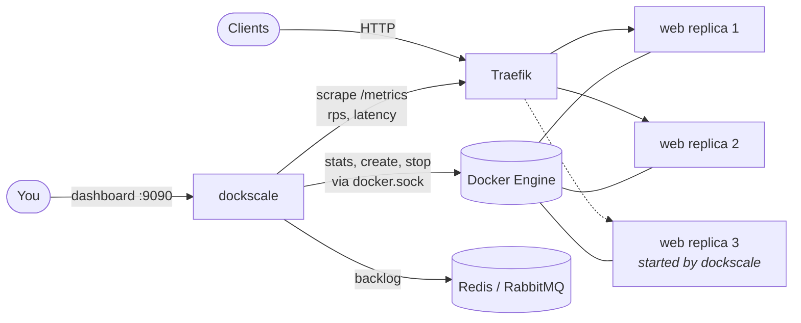
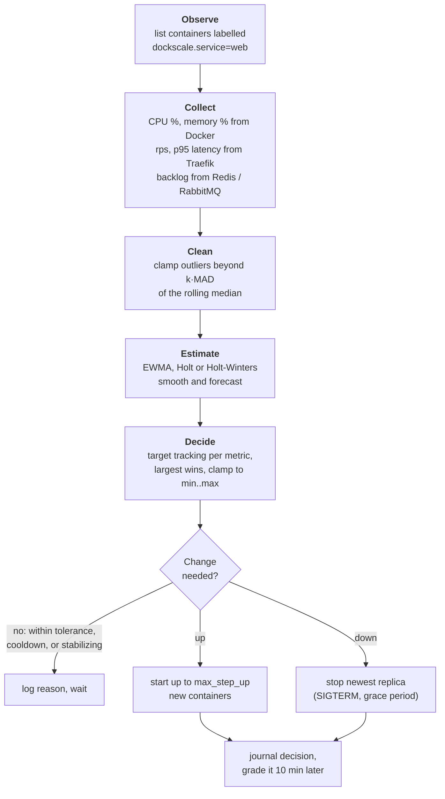
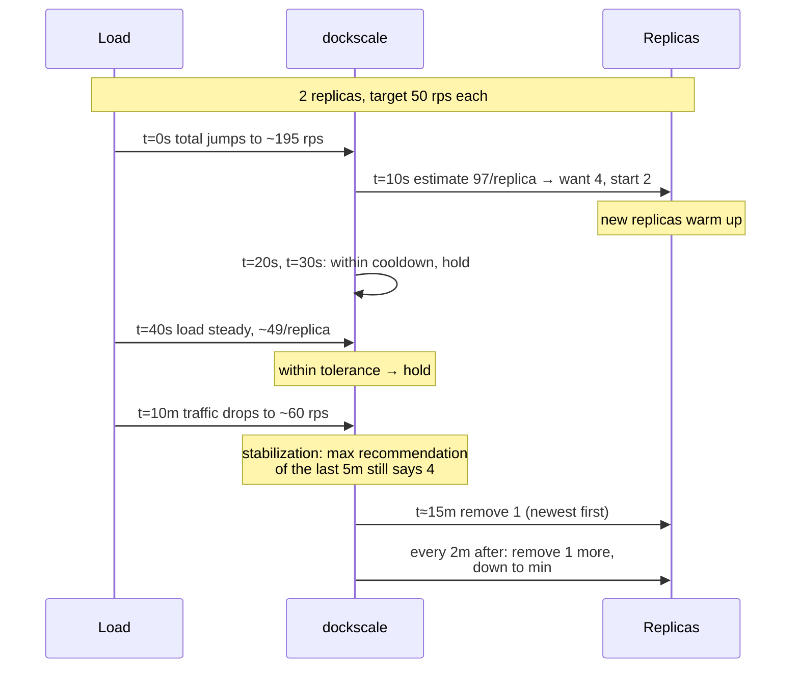

# dockscale

**A horizontal autoscaler for plain Docker on one host.** It watches how busy
a service's containers are, forecasts where the load is heading with simple
statistics, and starts or stops identical containers so each one stays near
the load you asked for. Traefik spreads traffic across them.

No Kubernetes, no Swarm, no machine learning. One small Go binary, a Docker
socket, and a YAML file.


| I want to… | Go to |
|---|---|
| Understand what it does | [The idea in 30 seconds](#the-idea-in-30-seconds) · [Follow one decision](#follow-one-decision-step-by-step) |
| See it running | [Try it](#try-it) |
| Configure it | [Configuration](#configuration) |
| Tune it without risk | [Tune offline with replay](#tune-offline-with-replay) |
| Read everything | [docs/](docs/README.md): [architecture](docs/architecture.md), [control loop](docs/control-loop.md), [metrics](docs/metrics.md), [models](docs/models.md), [policy](docs/policy.md), [memory](docs/memory.md), [web UI](docs/ui.md), [replay](docs/replay.md), [operations](docs/operations.md), [decisions](docs/decisions/README.md) |

## The idea in 30 seconds

You tell dockscale, per service: *"each replica should handle about 50
requests/s"* (or 60% CPU, or 100 queued messages). Every 10 seconds it
measures the real value, and if replicas are working too hard it adds more.
If they're idle, it removes some, slowly and carefully.



dockscale never talks to your app. It only reads metrics and uses the Docker
API. Traefik finds new replicas on its own through container labels.

## The control loop

Every `interval` (default 10s), for every service:



Docker is the source of truth: the replica count is re-read on every tick,
never cached, so if a container dies or someone removes one by hand,
dockscale simply notices and corrects.

## Follow one decision, step by step

A `web` service has **2 replicas**, a target of **50 rps per replica**, and
traffic just jumped to about 195 requests/s in total. Expand each step:

<details>
<summary><b>1. Observe and collect:</b> 2 replicas, ~97 rps each</summary>

dockscale lists containers labelled `dockscale.service=web` and finds 2
running. It scrapes Traefik's `/metrics`, takes the request counter's
increase since the last tick, and divides by the 2 replicas: **97.3 rps per
replica**. It does the same for CPU (from `docker stats`) and p95 latency
(from Traefik's histogram buckets).

</details>

<details>
<summary><b>2. Clean:</b> is this a real spike or one bad scrape?</summary>

The outlier filter keeps the last `outlier_window` (6) raw samples. A sample
more than `outlier_k` (3.5) × MAD from their median gets clamped. One weird
scrape can't trigger scaling, but a real, sustained jump takes over the median
within about 3 ticks.

</details>

<details>
<summary><b>3. Estimate:</b> where is the load heading?</summary>

The raw value goes through the service's model:

| model | what it does | good for |
|---|---|---|
| `raw` | nothing | baselines |
| `ewma` | `s = α·x + (1−α)·s`, smooths noise | steady services, lowest cost |
| `holt` | level + trend, forecasts `horizon` ticks ahead | scaling out *before* a ramp peaks |
| `holt_winters` | Holt + a learned offset for each time of day | daily patterns; it remembers yesterday's peak |

With `holt` and `horizon: 3`, a rising trend is extrapolated 30s ahead, so
the estimate can sit *above* the measurement while load climbs. The dashboard
shows both lines, so you can see it happen.

</details>

<details>
<summary><b>4. Decide:</b> ceil(2 × 97.3 / 50) = 4 replicas</summary>

Target tracking (the same formula as the Kubernetes HPA), per metric:

```
desired = ceil(current × estimate / target)
        = ceil(2 × 97.3 / 50) = ceil(3.89) = 4
```

The ratio 97.3 / 50 = 1.95 is well outside the ±10% `tolerance`, so this
counts as a change rather than noise. Each metric gets a vote, and **the
largest wins**: CPU says 2 and latency says 1, so rps wins with 4. The result
is clamped to `[min, max]`.

</details>

<details>
<summary><b>5. Guard rails:</b> fast up, slow down</summary>

| direction | rule | default |
|---|---|---|
| up | wait `scale_up_cooldown` after the last scale-up | 30s |
| up | add at most `max_step_up` per step | 4 |
| down | only shrink to the **highest** recommendation in the last `scale_down_stabilization` | 5m |
| down | wait `scale_down_cooldown` after any scaling | 2m |
| down | remove at most `max_step_down` per step | 1 |

Scaling up late costs you errors; scaling down early costs you a second
scale-up a minute later. So up is quick and down is deliberately slow.

Here nothing blocks it, so dockscale starts 2 new containers from the
template. Traefik picks them up by their labels.

</details>

<details>
<summary><b>6. Explain and grade:</b> every decision has a reason</summary>

The decision is logged with every metric's vote:

```
level=INFO msg=scale service=web from=2 to=4 reason="cpu=41.2/60.0->2 rps=97.3/50.0->4 latency_p95=88.0/200.0->1"
```

With `memory.dir` set, it's also journalled. dockscale watches the next 10
minutes and grades it: **effective** if the overload went away,
**insufficient** if it didn't, **unnecessary** if there was no real overload.
Scale-downs are graded **ok** or **premature**. The grades feed tuning advice
in the dashboard and in `dockscale-memory report`.

</details>

### What a spike looks like over time



## Memory: it learns your traffic

<details>
<summary>With <code>memory.dir</code> set, dockscale remembers what happened and uses it later</summary>

- **Learned state survives restarts.** Smoothing, Holt-Winters seasons and
  cooldowns are snapshotted and restored, so a restart no longer means a day
  of relearning.
- **Every decision is journalled and graded** (see step 6 above).
- **A load profile per time slot** ("every day at 09:00, rps is usually 400")
  drives `history.prewarm`, which scales out *before* recurring peaks. On a
  business-hours trace, it removed the 09:00 overload entirely once it had
  learned two days.

```sh
curl localhost:9090/history?service=web
dockscale-memory report -dir /var/lib/dockscale -config dockscale.yaml
```

Details: [docs/memory.md](docs/memory.md).

</details>

## Try it

<details open>
<summary><b>Dashboard only, no Docker needed</b> (fastest)</summary>

```sh
go run ./cmd/dockscale-demo     # then open http://localhost:9090
```

Runs the real controller against a fake Docker with synthetic load for two
services: an `api` with business-hours traffic and a `worker` with a nightly
batch. It fast-forwards three simulated days first, so the charts, grades and
load profile are already filled in. See [docs/ui.md](docs/ui.md).


</details>

<details>
<summary><b>Full stack with Docker:</b> Traefik + dockscale + whoami replicas</summary>

Requires Docker (Docker Desktop on Windows/macOS works).

```sh
docker compose up --build -d
docker compose logs -f dockscale        # watch decisions
curl localhost:9090/status              # current state per service
```

dockscale creates the 2 `min` replicas of `traefik/whoami`. To generate load:

```sh
docker run --rm --network dockscale_net williamyeh/hey -z 3m -c 50 http://traefik/
```

The rps signal climbs past 50/replica and the service scales out. After the
load stops, it scales back in one replica at a time, once the stabilization
window has passed.

To tear down, remove the stack and then the replicas, which compose doesn't own:

```sh
docker compose down
docker rm -f $(docker ps -aq --filter label=dockscale.managed=true)
```

</details>

<details>
<summary><b>Natively</b> (Go 1.26+), in dry-run mode</summary>

```sh
go run ./cmd/dockscale -config examples/dockscale.yaml -dry-run -v
```

`-dry-run` logs decisions without touching containers. Outside compose,
change `prometheus.url` to an address you can reach, such as
`http://localhost:8082/metrics`, after publishing that port on Traefik.

</details>

## Web UI

dockscale serves a read-only dashboard at `http://<host>:9090/`: replicas over
time, every signal against its target, graded decisions with tuning advice,
and the learned load profile. It's compiled into the binary, with no build
step and no external dependencies. It has no buttons that change anything,
because the port is unauthenticated. Details: [docs/ui.md](docs/ui.md).

## Tune offline with replay

`dockscale-replay` runs recorded load through **the same decision engine** the
controller uses, so you can compare policies without touching Docker.

```sh
# 1. Get a recording: record production...
dockscale -config dockscale.yaml -record load.csv
# ...or synthesise a few days of daily-cycle traffic with spikes
go run ./cmd/dockscale-replay generate -out load.csv -days 3 -base 20 -peak 400

# 2. Compare configs on identical load
go run ./cmd/dockscale-replay -in load.csv \
  -config examples/policies/raw.yaml -config examples/policies/ewma.yaml \
  -config examples/policies/holt.yaml -config examples/policies/holt_winters.yaml \
  -timeline timeline.csv
```

On the synthetic 3-day trace:

```
config        model         scale-ups  scale-downs  peak  replica-h  overload %
raw.yaml      raw                  53           88    14      386.9        0.69
ewma.yaml     ewma                 52           76    12      370.9        1.33
holt.yaml     holt                 66          113    14      395.1        0.65
holt_winters  holt_winters         93          178    15      428.2        0.58
```

EWMA is cheapest but lags behind spikes; Holt-Winters overloads least but
spends more replica-hours and scales more often. Tune against two numbers:
**replica-h** (cost) and **overload** (time some metric per *ready* replica
exceeded `target × (1 + tolerance)`).

<details>
<summary>How replay models load</summary>

Recordings store service-wide totals (summed CPU %, total rps, total queue
backlog), so the simulator can split the same load across a different replica
count. That assumes load divides evenly across replicas, which holds for CPU
and rps but not for latency, which is replayed as recorded.
`-startup-delay` (default 10s) models how long a new replica takes before it
serves load. `-timeline` writes per-tick replicas, raw and estimated signals,
and the reason for each decision. Details: [docs/replay.md](docs/replay.md).

</details>

## Configuration

Start from [examples/dockscale.yaml](examples/dockscale.yaml) (web service)
or [examples/worker.yaml](examples/worker.yaml) (queue worker).

```yaml
services:
  - name: web
    min: 2
    max: 10
    template: { image: traefik/whoami:latest, network: dockscale_net, cpus: 0.5 }
    metrics:
      - { type: rps, target: 50 }    # each metric votes; the largest wins
      - { type: cpu, target: 60 }
    model: { kind: holt, horizon: 3 }
    history: { prewarm: true }       # scale out before recurring peaks
```

| metric | source | meaning of `target` |
|---|---|---|
| `cpu` | Docker stats | % of `template.cpus` per replica (of 1 core if unset) |
| `memory` | Docker stats | % of the memory limit per replica |
| `rps` | Traefik `/metrics` | requests/sec per replica |
| `latency_p95` | Traefik `/metrics` | p95 latency in ms (from histogram buckets) |
| `queue_depth` | Redis list / RabbitMQ | pending messages per replica |

<details>
<summary>Queue sources</summary>

Redis uses `LLEN` on a list key (with AUTH/SELECT from the URL). RabbitMQ uses
the management API's `messages` count, which is ready plus unacked.

</details>

## Endpoints

| endpoint | returns |
|---|---|
| `GET /` | redirects to the dashboard at `/ui/` |
| `GET /status` | JSON per service: replicas, recommendation, desired count, signals, last reason |
| `GET /history?service=` | recent decisions with their grades |
| `GET /metrics` | `dockscale_replicas`, `dockscale_desired_replicas`, `dockscale_signal{metric,kind=raw\|estimate\|target}` |
| `GET /api/*` | compact JSON for the dashboard ([docs/ui.md](docs/ui.md#api-used-by-the-ui)) |
| `GET /healthz` | liveness |

Everything is read-only.

## Behaviour notes

<details>
<summary>Safety, restarts and edge cases</summary>

- dockscale only touches containers labelled `dockscale.managed=true`. When it
  restarts, it picks up existing replicas instead of creating new ones.
- Stopped replicas are removed and replaced on the next tick.
- Scale-down sends SIGTERM and waits `stop_timeout`. Traefik drops the replica
  as soon as it stops, but requests already in flight depend on the app
  shutting down gracefully.
- CPU needs two samples per container, so a new replica contributes CPU data
  from its second tick onwards.
- Latency doesn't fall in proportion to replica count, so using
  `latency_p95` together with `max_step_up` keeps overshoot in check.

</details>

## Testing

```sh
go test ./...                                        # unit + integration tests
go test -run '^$' -bench . ./internal/...            # benchmarks
go test -run '^$' -fuzz FuzzParse ./internal/metrics # fuzz the metrics parser
```

The Docker wrapper is tested against an in-memory fake of the Engine API
(`internal/docker/docker_test.go`). The controller is tested through a fake
`Docker` interface with an injected clock, so cooldown behavior can be checked
tick by tick.

## Roadmap

- [ ] Journal rotation, and automatic (opt-in) application of report advice
- [ ] Redis streams / consumer-group lag as a queue source
- [ ] Scale to zero, with activation on first request
- [ ] Docker Swarm / multi-host backend behind the same engine
