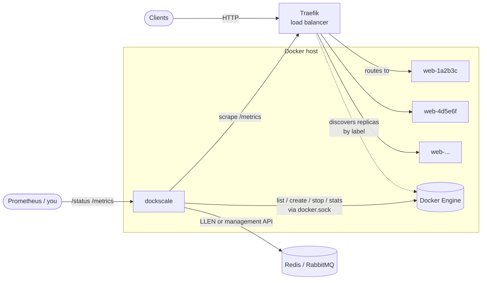
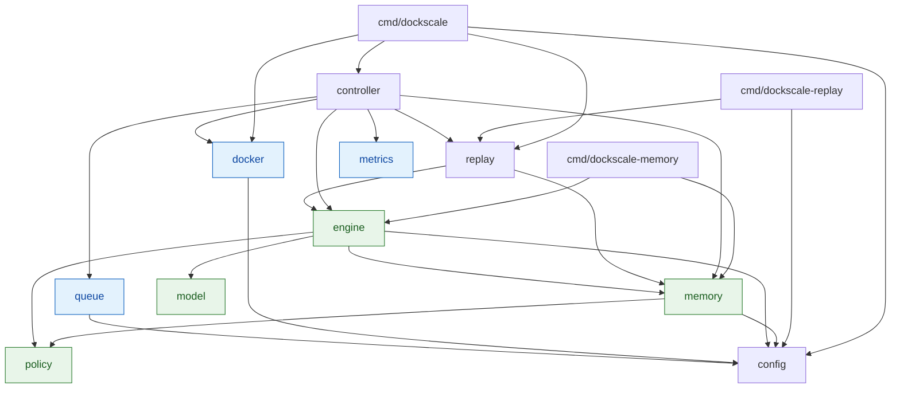
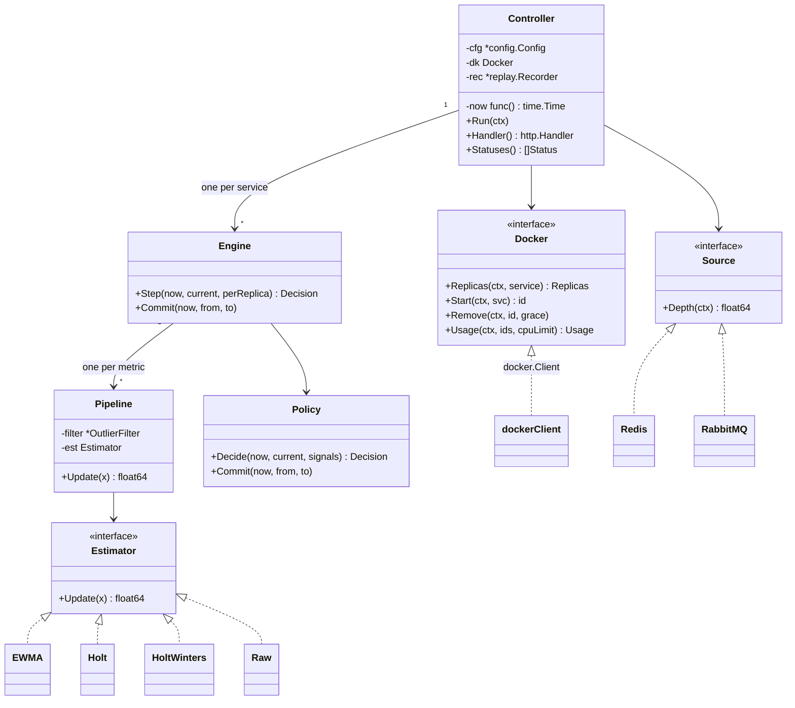
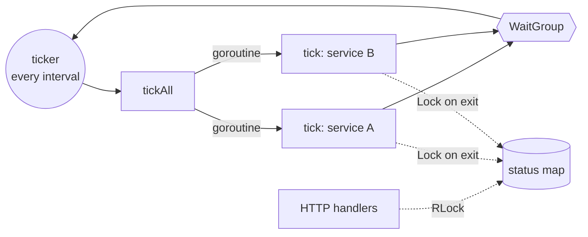

# Architecture

dockscale is a horizontal autoscaler for plain Docker on a single host. It runs
as one process (usually a container with the Docker socket mounted) and manages
the replicas of one or more *services*. Each replica is an ordinary container
created from a template.

It has no AI or ML components. Decisions come from classical time-series
statistics (robust outlier filtering, exponential smoothing, Holt and
Holt-Winters forecasting) feeding a target-tracking policy like the one in the
Kubernetes HPA.

## System context



dockscale never talks to the replicas directly. It acts only through the Docker
Engine API, and it observes load from two kinds of sources:

- **Docker stats:** CPU and memory per container.
- **External systems:** request rate and latency from Traefik, backlog from a
  queue.

Traefik finds new replicas by itself through Docker labels. dockscale's only
job on the routing side is to put the right labels on the containers it creates.

## Package layout

```
cmd/
  dockscale/          main: flags, wiring, HTTP server, signal handling
  dockscale-replay/   offline simulator CLI (generate + compare)
  dockscale-memory/   inspect memory: decisions, report, profile
internal/
  config/      YAML loading, defaults, validation
  controller/  the control loop and HTTP endpoints
  engine/      per-service decision core: models + policy (no I/O)
  model/       statistical estimators (outlier filter, EWMA, Holt, Holt-Winters)
  policy/      target tracking, tolerance, cooldowns, stabilization (no I/O)
  memory/      load profile, decision grading, report (no I/O) + file store
  docker/      Docker Engine API wrapper: replicas, start, remove, usage
  metrics/     Prometheus text parser, histogram quantile, Traefik scraper
  queue/       queue backlog sources: Redis list, RabbitMQ
  replay/      CSV recorder, synthetic load generator, simulator
```

### Dependency graph



Green packages are **pure**: no I/O, no clocks, no goroutines. Blue packages
do I/O. `memory` is pure except for `store.go`, its file store, which only the
controller and the CLIs use. This split is the most important structural rule in the codebase:

- `engine`, `model` and `policy` take time as a parameter and never call
  `time.Now()`. That makes them deterministic and unit-testable, and lets
  the replay tool run three days of decisions in about 60 ms.
- The live `controller` and the offline `replay` simulator use **the same
  `engine.Engine`**. A policy that behaves well in replay behaves the same way
  in production, given the same inputs.

## Key types



## State

Without `memory.dir`, all state is in memory only. With it, learned state and
the decision journal persist (see [memory.md](memory.md)).

| State | Owner | Lifetime |
|---|---|---|
| Which containers are replicas | Docker itself, via labels | Survives dockscale restarts |
| Previous CPU counters per container | `docker.Client` | Process lifetime; one is dropped when its container is removed |
| Smoothed level, trend, seasonal offsets | `model.*` inside each `Engine` | Saved to `state-<service>.json` and restored (short-term parts only if fresh) |
| Last scale-up and scale-down times, recommendation history | `policy.Policy` | Saved and restored |
| Load profile per time slot | `memory.Profile` inside each `Engine` | Saved and restored |
| Decisions and their graded outcomes | `memory.Evaluator`, `journal.jsonl` | Append-only journal; the last 200 per service are kept in memory for `/history` |
| Previous Traefik counter values | `metrics.Traefik` | Process lifetime |
| Last status per service | `Controller` (behind a RWMutex) | Overwritten every tick |

The source of truth for "how many replicas exist" is always Docker. dockscale
re-reads it on every tick and never trusts its own count. So when it restarts,
it adopts the existing replicas instead of creating new ones. Containers removed
by hand are noticed and replaced on the next tick.

## Concurrency



- Each tick processes all services in parallel, one goroutine each, and waits
  for all of them before the next tick. A service's `Engine` is only ever
  touched by its own goroutine, so the models and policy need no locks.
- Within one service, container stats are fetched in parallel, and replicas are
  started or stopped in parallel.
- If a tick runs longer than the interval, the Go ticker keeps at most one
  pending tick and drops the rest. The next tick may start straight away, but a
  slow Docker daemon can't cause a backlog of ticks.
- HTTP handlers read a snapshot of the status under a read lock.

## Design decisions

| Decision | Why | Trade-off |
|---|---|---|
| Single host, Docker API only | It's the simplest thing that works and needs no orchestrator | No multi-host scheduling (see roadmap) |
| Labels as the source of truth | dockscale itself stays stateless, adopts replicas after a restart, and never touches containers it didn't create | Anyone can fake the labels on a container |
| Traefik for routing | Traefik discovers containers by label with zero coupling, and exposes the request metrics we need | Request metrics depend on Traefik's metric names |
| Statistical models, not ML | Predictable, explainable, cheap, with no training data needed | Can't learn complex non-periodic patterns |
| Per-replica targets, HPA formula | A well-understood method that combines several metrics naturally | Assumes load spreads evenly, which is weakest for latency |
| Pure engine shared with replay | Offline tuning is trustworthy because it runs the exact production logic | The engine can't do I/O |
| Minimal dependencies | Hand-written Prometheus parser and Redis RESP client, no metrics or Redis SDK | More code of our own to maintain |
| Scale down newest first | Old replicas are warm and hold long-lived connections | Uneven container ages over time |
| Memory as plain files (JSONL + JSON), no database | Zero dependencies, easy to read with `jq`, atomic state writes | One writer per directory, manual journal rotation |
| Seasonal slots aligned to the wall clock | Seasons and profiles stay valid across gaps and restarts | Slots are in UTC, so daylight-saving shifts take a few days to heal |
