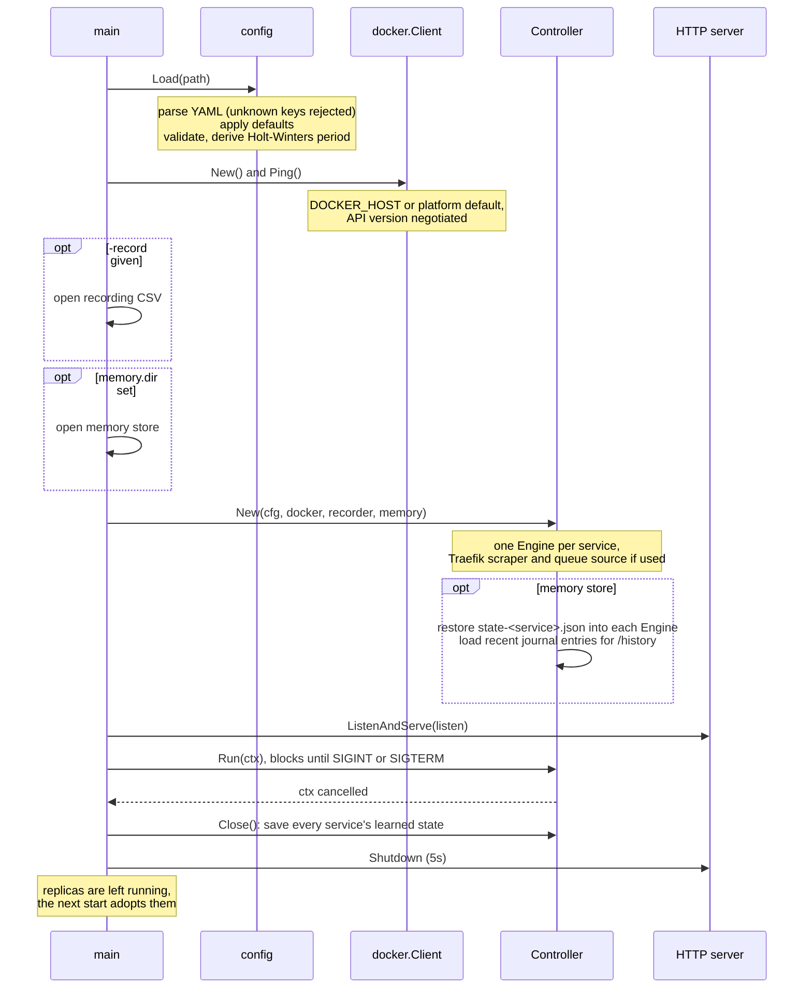
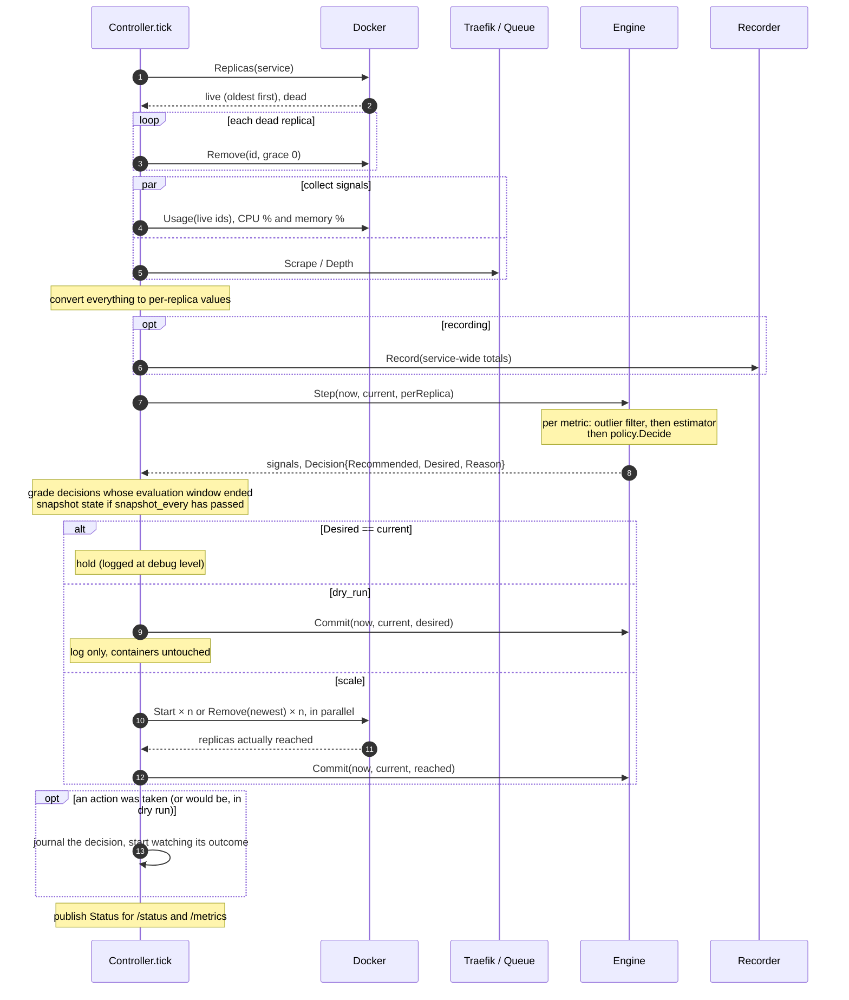
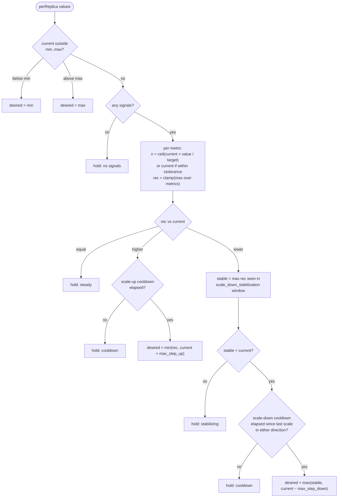
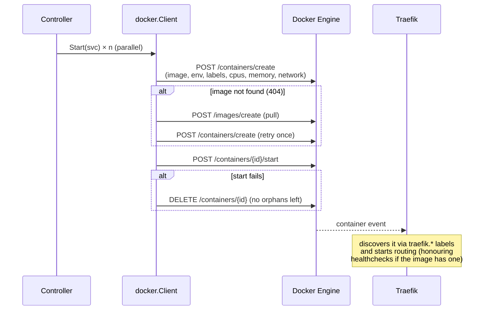
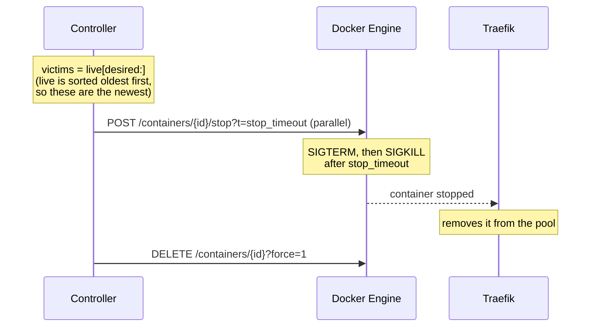

# Control loop flow

Everything dockscale does happens in one loop. It runs once at startup and then
every `interval` (default 10s). Each iteration is called a **tick**.

## Startup



## One tick

Each service is handled independently and in parallel. This is the sequence for
one service:



### Step by step

1. **Observe.** List all containers labelled `dockscale.managed=true` and
   `dockscale.service=<name>`. States `running`, `restarting` and `paused` count
   as live. Anything else (`exited`, `dead`, `created`) is dead.
2. **Clean up.** Remove dead replicas. Replicas use the `unless-stopped`
   restart policy, so a crashing container is restarted by Docker itself. A
   container is only dead here if something stopped it from outside. Removing
   it lets the next step replace it.
3. **Collect.** Read each configured metric and normalize it to a
   **per-replica** value (see [metrics.md](metrics.md)). A metric that can't be
   read this tick is simply left out. It doesn't block the others, and it
   doesn't count as zero.
4. **Record** (optional). Append the service-wide totals to the recording CSV
   for later replay (see [replay.md](replay.md)).
5. **Estimate.** Each metric's value goes through its own pipeline: outlier
   filter, then estimator (see [models.md](models.md)). The service-wide totals
   also update the load profile, and with `history.prewarm` it adds
   `metric@history` signals (see [memory.md](memory.md)).
6. **Decide.** The policy turns the estimates into a desired replica count (see
   [policy.md](policy.md)).
7. **Act.** Start or remove the difference in parallel. Scale-down removes the
   **newest** replicas first.
8. **Commit.** Tell the policy what actually happened, which starts the
   cooldowns. dockscale commits the replica count it actually *reached*, not the
   one it asked for.
9. **Remember.** Grade earlier decisions whose `evaluate_after` window has
   ended, journal this tick's decision if there was one, and save a state
   snapshot every `snapshot_every`.
10. **Publish.** Store the `Status` (replicas, recommendation, signals, reason,
   last error) for the HTTP endpoints.

## Decision flow



Every branch sets a human-readable `Reason`. It's logged and shown in
`/status`, so any decision can be explained after the fact:

```
level=INFO msg=scale service=web from=2 to=4 reason="cpu=41.2/60.0->2 rps=97.3/50.0->4 latency_p95=88.0/200.0->1"
```

Each `metric=value/target->n` entry shows the smoothed value, the target, and
the replica count that metric alone would ask for. The largest wins.

## Scale-up flow



Replica names are `<service>-<6 random hex chars>`. dockscale adds two labels
of its own (`dockscale.managed=true`, `dockscale.service=<name>`) to the
template's labels.

## Scale-down flow



## Failure handling

| Failure | What happens |
|---|---|
| Docker API unreachable when listing | Tick aborted, `LastError` set, no scaling. Retried next tick. |
| Stats fail for some replicas | Those replicas are left out of the average and a warning is logged. If none succeed, the CPU and memory signals are skipped. |
| Traefik or queue unreachable | Those signals are skipped this tick. Scaling continues on the remaining signals. With none left, the policy holds. |
| Only some starts succeed | dockscale commits the count it reached, so the scale-up cooldown starts and there's no retry storm. The error is logged and surfaced. It retries after the cooldown. |
| Image pull fails | Counts as a failed start (as above). |
| A replica is removed by hand | It no longer appears in the list, so it's replaced on the next tick if the policy wants it. |
| dockscale crashes or restarts | Replicas keep running and are adopted by label. With `memory.dir`, learned state is restored from the last snapshot (at most `snapshot_every` old after a crash). Without it, the estimators warm up again and Holt-Winters relearns its season. |
| Memory directory not writable | Startup fails if it can't be opened. Later write failures are logged as warnings and scaling continues. |
| A tick is slower than the interval | At most one missed tick is kept, the rest are dropped. Observation uses a timeout of one interval; scaling actions get up to 3 minutes. |
| Stopped (not crashed) replica | Removed during cleanup, then replaced if still needed. |

## Timeline example

`interval: 10s`, `scale_up_cooldown: 30s`, `scale_down_cooldown: 2m`,
`scale_down_stabilization: 5m`, rps target 50 per replica:

```
t=0s     2 replicas, 200 rps total → 100/replica → rec 4  → scale 2→4
t=10s    4 replicas, 50/replica    → steady
t=40s    load 400 rps → 100/replica → rec 8; cooldown ended → scale 4→8
t=3m     load drops to 100 rps → 12.5/replica → rec 2
         stabilization window still holds rec 8 → hold ("stabilizing")
t=8m     window has aged out the high recommendations → stable 2
         cooldown elapsed → scale 8→7 (max_step_down 1)
t=10m    → 7→6 … continues one replica every 2m down to 2
```

Scale-up is quick and scale-down is slow and gradual. That asymmetry is
deliberate: being short of capacity costs errors, while extra capacity only
costs money.
