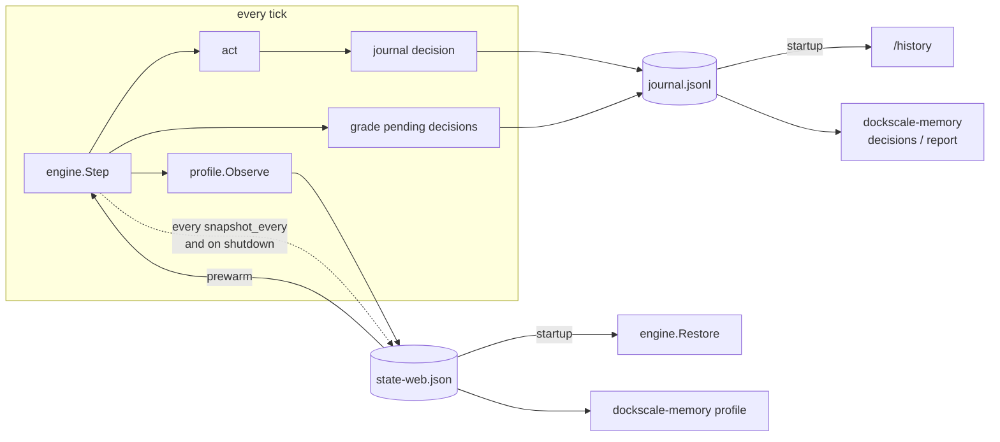

# Memory

dockscale remembers three things about the past and uses each one for future
decisions:

| What it remembers | Stored as | How it's used |
|---|---|---|
| **Learned state**: smoothing levels, trends, Holt-Winters seasons, cooldown times, the stabilization window | `state-<service>.json`, replaced atomically | Restored at startup, so a restart doesn't wipe what the models learned |
| **Decisions and outcomes**: every scaling action, why it was taken, and how it turned out | `journal.jsonl`, append-only | `/history`, the `dockscale-memory` report and its tuning advice |
| **Load profile**: typical load per time slot of a day (or week) | Inside the state file | `history.prewarm` adds capacity before recurring peaks |

Everything stays in memory only unless `memory.dir` is set. It's plain files
with no database or extra dependencies, and it's all statistics, no ML.



## Configuration

```yaml
memory:
  dir: /var/lib/dockscale   # enables persistence; mount it as a volume
  snapshot_every: 1m        # how often learned state is saved
  max_state_age: 15m        # older snapshots restore only long-term memory
  evaluate_after: 10m       # watch each decision this long before grading it

services:
  - name: web
    history:
      prewarm: false        # use the profile to scale ahead of recurring peaks
      cycle: 24h            # 168h for weekly patterns
      slot: 15m             # profile resolution; must divide cycle, >= interval
      lead: 5m              # also look this far ahead
      sigma: 1              # headroom in standard deviations
      min_samples: 2        # visits to a slot before it is trusted
      decay: 0.25           # weight of the newest visit once a slot has history
```

In Docker, mount the directory so it survives container restarts:

```yaml
dockscale:
  volumes:
    - dockscale-memory:/var/lib/dockscale
volumes:
  dockscale-memory:
```

## 1. Learned state survives restarts

Each service's engine is saved every `snapshot_every` and on shutdown, and
restored at the next start. On restore, what comes back depends on the
snapshot's age:

| Part | Fresh (age ≤ `max_state_age`) | Stale (older) |
|---|---|---|
| Outlier filter window | restored | dropped |
| EWMA value, Holt level and trend | restored | dropped, so the model warms up again |
| Holt-Winters seasonal offsets | restored | **restored**; the level is re-anchored on the first new sample |
| Holt-Winters warm-up progress | restored | restored |
| Cooldown times, stabilization window | restored | restored (absolute times, so they expire naturally) |
| Load profile | restored | restored |

Short-term state describes *current* load, so after a long outage it would
mislead the models. Long-term state describes the *usual* load, so it stays
valid. Each part is checked against the config: if you changed a metric's model
kind or the season length, that part is skipped and a log line says why.

```
level=INFO msg="restored memory" service=web detail="snapshot age 3m12s (fresh=true)"
level=INFO msg="restored memory" service=web detail="rps: model state skipped: model kind changed from ewma to holt"
```

**Why Holt-Winters seasons can be restored at all:** seasonal slots are aligned
to the wall clock (`slot = (unix time mod season_length) / interval`), not to a
tick counter. A tick at 14:15 always updates the 14:15 slot, whatever gaps or
restarts came before. With a counter, any gap would shift the whole season.

Snapshots are written to a temp file and renamed into place, so a crash can't
leave a half-written state file. A corrupt state file is logged and ignored,
and the service starts fresh.

## 2. Decisions are journalled and graded

Every scaling action (including dry-run ones, marked as such) is appended to
`journal.jsonl` with what was asked for, what was reached, the reason, and every
signal behind it:

```json
{"type":"decision","decision":{"id":"web-mfx2k1","at":"2026-10-17T09:00:10Z","service":"web",
 "from":2,"to":9,"wanted":9,"recommended":9,
 "reason":"rps=10.9/50.0->1 rps@history=420.0/50.0->9","signals":[...]}}
```

For `evaluate_after` (default 10 minutes), dockscale keeps watching the live
signals, then grades the decision:

| Direction | Verdict | Meaning |
|---|---|---|
| up | `effective` | Load came back within target |
| up | `insufficient` | More than half the window was still over target: it didn't add enough |
| up | `unnecessary` | Undone within the window: the count fell back to where it started |
| down | `ok` | No overload afterwards |
| down | `premature` | Over target for more than 20% of the window, or undone by a scale-up |

"Over target" means some live metric's raw per-replica value is above
`target × (1 + tolerance)`. History (`@history`) signals are forecasts, so they
never count. A decision only counts as *undone* if it's actually reversed. For
example, in `2→3`, then `3→5`, then `5→4`, neither scale-up is blamed, because
the count never dropped back to 2 or 3.

```json
{"type":"outcome","outcome":{"decision_id":"web-mfx2k1","verdict":"effective",
 "overload_fraction":0.02,"peak_ratio":1.08,"reversed":false,"ticks":60}}
```

Outcomes are also logged as they happen:

```
level=INFO msg="decision outcome" service=web decision=web-mfx2k1 verdict=effective overload=2% peak_ratio=1.08
```

Decisions still being watched when dockscale stops are never graded. Their
entry stays "pending".

## 3. The load profile and prewarm

The profile learns the typical **service-wide** load for each `slot` of a
`cycle`. All the ticks inside one slot form a *visit*, and the visit's mean
updates that slot's statistics:

```
w     = max(1/n, decay)        # n = visits so far, including this one
mean ← mean + w·(x − mean)
var  ← (1 − w)·(var + w·(x − mean_old)²)
```

The first visits are averaged equally. After that, recent cycles count more
(`decay` 0.25 means today counts for a quarter), so the profile follows gradual
change without being thrown off by one odd day.

With `prewarm: true`, every additive metric (cpu, memory, rps, queue_depth)
gets an extra signal on each tick:

```
expected = max(profile(now), profile(now + lead)),   using mean + sigma·stddev
signal   = metric@history, value = expected / current replicas
```

The policy treats it like any other signal: the largest recommendation wins,
and cooldowns, step limits and stabilization all still apply. In practice:

- **Before a recurring peak**, `profile(now + lead)` asks for the peak's
  capacity, so replicas are started *before* the load arrives.
- **During the usual busy hours**, it keeps capacity even if this day happens to
  be quieter. That's the cost of prewarm.
- **Unpredictable spikes** are still handled by the live signals. The profile
  only knows what usually happens.

A slot isn't used until it has `min_samples` visits, so with a daily cycle,
prewarm starts working on day 3.

### Effect, measured with replay

Four days of synthetic business-hours load (`-shape step`: an abrupt jump from
20 to 400 rps at 09:00, back at 17:00), with a 30s replica start-up delay:

| config | replica-hours | time overloaded | overloaded ticks at 09:00, days 3–4 |
|---|---|---|---|
| holt | 440.7 | 19m0s | 9 per day |
| holt + prewarm | 442.9 (+0.5%) | 16m0s | **0** |

On days 3 and 4, prewarm scaled from 2 to 9 replicas at 08:56, before the jump.
Without it, the jump overloads 2 replicas for about 1.5 minutes while new ones
start. The remaining overload in both rows comes from random spikes, which no
history can predict.

On a smooth daily ramp (`-shape sine`), prewarm makes **no** difference,
because Holt already follows a gradual ramp. Use prewarm for abrupt, recurring
changes: business hours, scheduled batch jobs, a daily campaign send.

## Using the memory

### `/history`

```sh
curl 'localhost:9090/history?service=web&limit=20'
```

This returns recent decisions with their outcomes, newest first. It holds the
last 200 per service and is reloaded from the journal at startup.

### `dockscale-memory`

```sh
# What happened, and how it turned out. This is real output from the replay
# under "Trying it without Docker": prewarm scales 2→6→9 at 08:55, while live
# rps alone would still ask for 1 replica.
dockscale-memory decisions -dir /var/lib/dockscale -service web -since 24h

TIME (UTC)      SERVICE  CHANGE  VERDICT      OVERLOAD  REASON
01-08 08:55:00  web      2→6     effective    0%        cpu=5.4/60.0->1 rps=10.7/50.0->1 cpu@history=110.7/60.0->4 rps@history=221.4/50.0->9
01-08 08:55:30  web      6→9     effective    0%        cpu=3.5/60.0->1 rps=7.0/50.0->1 cpu@history=36.9/60.0->4 rps@history=73.8/50.0->9
01-08 09:00:40  web      9→11    effective    0%        cpu=30.5/60.0->5 rps=61.1/50.0->11 cpu@history=24.6/60.0->4 rps@history=49.2/50.0->9
01-08 09:01:10  web      11→14   unnecessary  0%        cpu=29.9/60.0->6 rps=59.8/50.0->14 cpu@history=20.1/60.0->4 rps@history=40.3/50.0->9
01-08 09:06:40  web      14→13   ok           0%        cpu=15.8/60.0->4 rps=31.7/50.0->9 cpu@history=15.8/60.0->4 rps@history=31.6/50.0->9

# How well the policy is working, with advice based on your current config
dockscale-memory report -dir /var/lib/dockscale -config dockscale.yaml -since 168h

== web (last 168h0m0s)
   188 decisions (55 up, 133 down), 1.96 per hour, 0 failed
   scale-ups:   40 effective, 0 insufficient, 15 unnecessary
   scale-downs: 114 ok, 19 premature
   → No tuning issues detected.

# What the profile has learned (here from four days of a smooth daily ramp)
dockscale-memory profile -dir /var/lib/dockscale -service web -metric rps

SLOT (UTC)  VISITS  MEAN   STDDEV
03:00       4       20.1   0.1     █
09:00       4       218.1  3.6     ███████████
15:00       4       410.6  16.3    ████████████████████
```

`-since` counts back from the newest journal entry, so it works the same way on
a live journal and on one written by `dockscale-replay -memory-dir`. Every
subcommand accepts `-json`.

The report gives advice once there are at least 5 graded decisions:

| Finding | Threshold | Advice |
|---|---|---|
| Premature scale-downs | > 20% of graded downs | Raise `scale_down_stabilization` or `scale_down_cooldown` |
| Insufficient scale-ups | > 30% of graded ups | Raise `max_step_up`, lower `scale_up_cooldown`, use `holt`; consider `prewarm` |
| Unnecessary scale-ups | > 30% of graded ups | Raise `tolerance`, or smooth more |
| Flapping | > 6 actions per hour | Raise `tolerance` or `scale_down_stabilization` |
| Failed actions | any | Check `last_error` |

The advice never changes the config by itself. Test a suggested change with
`dockscale-replay` on a recording before deploying it.

### Trying it without Docker

`dockscale-replay -memory-dir DIR` writes the same journal and state files a
live run would, so the whole workflow can be tried offline:

```sh
dockscale-replay generate -shape step -days 4 -out load.csv
dockscale-replay -in load.csv -config examples/policies/holt_prewarm.yaml -memory-dir ./mem
dockscale-memory report -dir ./mem -config examples/policies/holt_prewarm.yaml
```

## Limits

- **One writer per directory.** Two dockscale processes sharing `memory.dir`
  would interleave the journal and overwrite each other's state.
- **The journal grows without limit.** It's small (one line per scaling action,
  about 1 KB with signals, so ~200 actions a day is about 0.2 MB/day), but
  rotate or trim it yourself for now.
- **Profile slots are in UTC.** With a 24h cycle, a daylight-saving shift moves
  local peaks by an hour against the profile. That heals over a few days
  through `decay`.
- **A visit cut short by a restart isn't counted.**
- **Grading is heuristic.** "Unnecessary" can't tell a noise spike apart from a
  brief real burst that ended. Use the verdicts as trends across many
  decisions, not as judgments on single ones.
