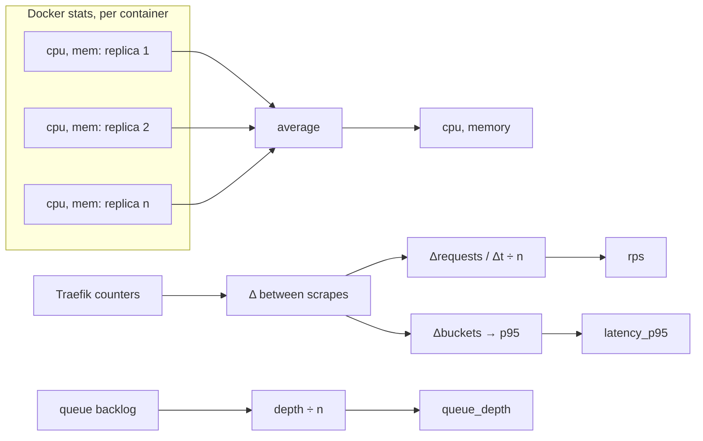

# Metrics

Each metric becomes a **per-replica** value that the policy compares with the
metric's `target`. The policy's formula `ceil(current × value / target)` only
makes sense if the value is per replica.

| `type` | Source | Per-replica value | Unit of `target` |
|---|---|---|---|
| `cpu` | Docker stats | Average across live replicas | % of `template.cpus` (of one core if unset) |
| `memory` | Docker stats | Average across live replicas | % of the container memory limit |
| `rps` | Traefik `/metrics` | Total rps ÷ live replicas | requests/second |
| `latency_p95` | Traefik `/metrics` | Not divided: one value for the whole service | milliseconds |
| `queue_depth` | Redis list or RabbitMQ | Total backlog ÷ live replicas | messages |

For the additive metrics (all except latency), the formula simplifies nicely.
For example, with rps: `ceil(current × (total/current) / target) = ceil(total / target)`.
The replica count is just the total load divided by what one replica should
handle.



## CPU

dockscale uses one-shot stats requests (no streaming connection per container).
One-shot responses don't include the previous sample, so the client keeps the
last `total_usage` and `system_cpu_usage` counters for each container and works
out the change itself. It's the same formula `docker stats` uses:

```
cores = (Δ container total_usage / Δ host system_cpu_usage) × online_cpus
cpu % = cores / template.cpus × 100      (or cores × 100 when cpus is unset)
```

So with `cpus: 0.5`, a replica using half a core reads as **100%**. Targets are
always relative to what the replica is allowed to use.

A newly seen container has no previous sample, so it contributes CPU data
from its **second** tick onwards.

## Memory

```
used     = usage − inactive_file        (cgroup v2; total_inactive_file on v1)
memory % = used / limit × 100
```

Inactive page cache can be reclaimed, so it's excluded, as in `docker stats`.
Without a memory limit, `limit` is the host's memory and the percentage is
correspondingly small. Set `template.memory` if you scale on memory.

Memory is a weak scaling signal for most services, because adding replicas
rarely lowers the memory each one uses. It's most useful as a safety signal
next to CPU or rps.

## Request rate and latency (Traefik)

Traefik exposes cumulative counters. dockscale scrapes them every tick and
works with the **difference between consecutive scrapes**:

- `traefik_service_requests_total{service="<prometheus.service>"}`: all series
  for the service, summed across status codes, methods and protocols.
- `traefik_service_request_duration_seconds_bucket{service=…, le=…}`: the
  cumulative latency histogram, summed per `le` across series.

```
rps         = Δ requests_total / Δt
latency_p95 = histogram_quantile(0.95, Δ buckets) × 1000
```

The quantile uses linear interpolation within the bucket, like PromQL's
`histogram_quantile`, and the result is clamped to the bucket's bounds. If the
95th percentile falls in the `+Inf` bucket, the result is the highest finite
bucket bound.

> **Configure finer latency buckets.** Traefik's default buckets are only
> `0.1, 0.3, 1.2, 5` seconds. With those, any p95 between 300ms and 1.2s is
> interpolated inside a single bucket, and anything above 5s reads as 5s.
> Set buckets around your target, for example for a 200ms target:
>
> ```
> --metrics.prometheus.buckets=0.025,0.05,0.1,0.15,0.2,0.25,0.3,0.5,1,2.5,5
> ```
>
> The demo `docker-compose.yml` does this.

Edge cases:

- **First scrape** only sets a baseline and produces no signal.
- **No traffic** in the interval: `rps = 0`, which is a real signal and lets
  the service scale toward `min`. Latency is *skipped*, not treated as 0,
  because there's nothing to measure.
- **Counter reset** (Traefik restarted): if a value goes down, the new value is
  used as the change.

`prometheus.service` must match Traefik's service name. With the label
`traefik.http.services.web.loadbalancer.server.port`, that name is `web@docker`.

The Prometheus text parser (`internal/metrics/prom.go`) is hand-written and
fuzz-tested. It handles quoted label values containing `}`, `,` and escaped
quotes, optional timestamps, and `+Inf`/`NaN`, and it skips malformed lines.

## Queue depth

For worker services, the backlog is what matters, not CPU.

| `queue.kind` | How it is read | What is counted |
|---|---|---|
| `redis_list` | `LLEN <name>` over a short-lived TCP connection. `AUTH` and `SELECT` come from the URL. | Items in the list |
| `rabbitmq` | `GET /api/queues/<vhost>/<name>` on the management API, with basic auth from the URL | `messages`: ready + unacknowledged |

URL formats:

```
redis://[[user]:password@]host[:6379][/db]
http[s]://user:password@rabbitmq-host:15672
```

The default RabbitMQ vhost `/` is sent correctly as `%2F`.

**Choosing the target:** set it to the backlog one worker can clear within an
acceptable delay. For example, if a worker handles 10 jobs per second and a
10-second backlog is acceptable, use `target: 100`.

## Combining metrics

When several metrics are configured, each one is smoothed separately, each
produces its own replica count, and **the largest wins**. Adding a metric can
only add capacity, never take it away. A typical web setup is `rps` as the
main signal, `cpu` as a safety net, and `latency_p95` to catch slow
dependencies.

**Latency caveat:** latency doesn't fall in proportion to replica count. If p95
is twice the target, doubling the replicas may not halve it, for example when a
slow database is the cause. The policy still asks for twice the replicas, so
keep `max_step_up` and `max` sensible when scaling on latency.
