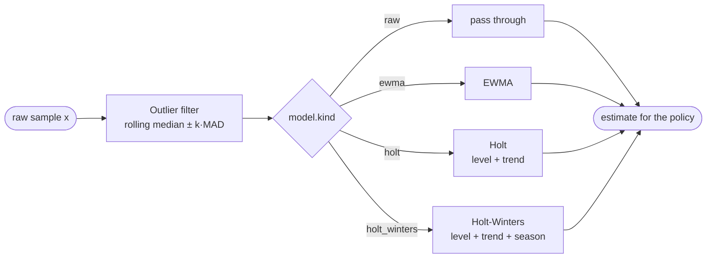
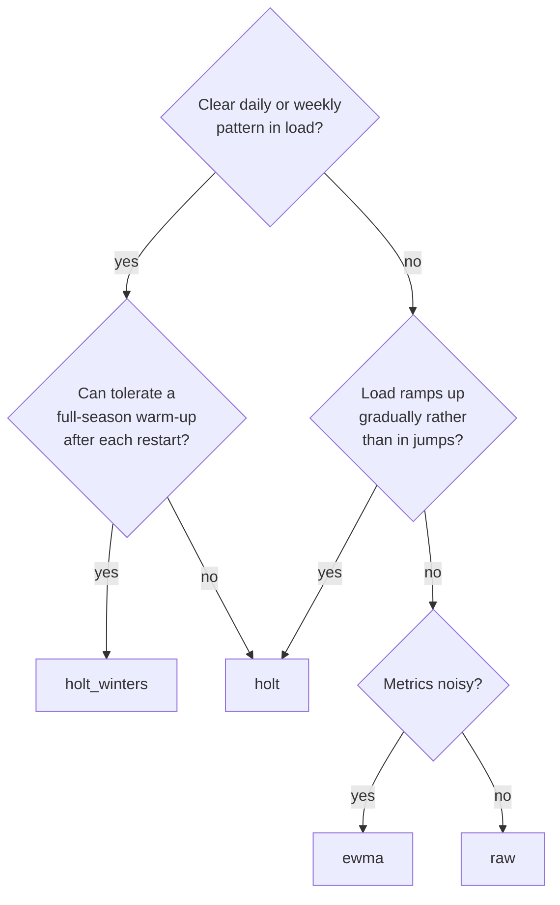

# Statistical models

Raw metrics are noisy. A single slow scrape, a GC pause or a burst of
requests can each produce a sample that, if acted on, would add replicas that
are removed again minutes later. Each metric therefore goes through a small
**pipeline** before the policy sees it:



Each metric has its own pipeline with its own state. All models are
`O(1)` per sample except the outlier filter, which is `O(w log w)` for window
size `w`. They're all negligible at a 10s interval. See the benchmarks in
`internal/model/model_bench_test.go`.

## Outlier filter (median ± k·MAD)

A robust filter that clamps samples sitting too far from recent history.

```
med   = median(last w samples)
MAD   = 1.4826 × median(|xᵢ − med|)
bound = k × MAD
out   = clamp(x, med − bound, med + bound)
```

- The **median** and **MAD** (median absolute deviation) are robust: one huge
  outlier barely moves them, while it would drag a mean and standard deviation
  along with it.
- The factor 1.4826 makes MAD estimate the standard deviation for normally
  distributed data. So `k = 3.5` means "clamp beyond about 3.5σ".
- The window stores **raw** samples, not clamped ones. A real, sustained shift
  in load therefore becomes the new median after about `w/2` ticks and then
  passes through unchanged. The filter delays real changes; it doesn't block
  them.
- It needs at least 5 samples before it acts. If `MAD = 0` (perfectly flat
  history), nothing is clamped.

| Setting | Default | Effect |
|---|---|---|
| `outlier_k` | 3.5 | Lower clamps more aggressively. `-1` disables the filter. |
| `outlier_window` | 6 | Larger is steadier but slower to accept real shifts (about `w/2` ticks). |

**Trade-off:** with the defaults (`w = 6`, 10s interval), a genuine step up in
load is delayed by about 30 seconds. Lower the window for faster reaction, or
disable the filter if your metrics are already clean.

## EWMA: exponentially weighted moving average

```
s₀ = x₀
sₜ = α·xₜ + (1 − α)·sₜ₋₁
```

Recent samples count most, and older ones fade geometrically. The time
constant is about `1/α` ticks. With the default `α = 0.5`, that's about 2 ticks,
or 20s.

Use EWMA when load is noisy but has no strong trend or daily pattern. It always
lags behind a rising load, which is its main weakness for scale-up.

## Holt: double exponential smoothing

Holt tracks a **level** `ℓ` and a **trend** `b` (change per tick), and returns a
forecast `h` ticks ahead:

```
ℓₜ = α·xₜ + (1 − α)·(ℓₜ₋₁ + bₜ₋₁)
bₜ = β·(ℓₜ − ℓₜ₋₁) + (1 − β)·bₜ₋₁
ŷ  = max(0, ℓₜ + h·bₜ)
```

Because it returns where load is *heading* (`horizon` ticks ahead) rather than
where it is now, scale-out starts before the load arrives. That covers part of
the time a new replica takes to start.

| Setting | Default | Effect |
|---|---|---|
| `alpha` | 0.5 | Smoothing of the level |
| `beta` | 0.3 | Smoothing of the trend. Higher reacts faster to trend changes but is noisier. |
| `horizon` | 3 | How many intervals ahead to forecast. Set it to about your replica start-up time ÷ interval. |

The forecast is floored at 0. A falling trend can't produce negative load.

## Holt-Winters: triple exponential smoothing (additive)

Holt-Winters adds a **seasonal** part: one offset `s[i]` for each position `i`
in a cycle of `P = season_length / interval` ticks. For a daily cycle at 10s,
`P = 8640`.

```
i  = t mod P
ℓₜ = α·(xₜ − s[i]) + (1 − α)·(ℓₜ₋₁ + bₜ₋₁)
bₜ = β·(ℓₜ − ℓₜ₋₁) + (1 − β)·bₜ₋₁
s[i] ← γ·(xₜ − ℓₜ) + (1 − γ)·s[i]
ŷ  = max(0, ℓₜ + h·bₜ + s[(i + h) mod P])
```

The seasonal offset in the forecast is the one for the **future** position
`i + h`. So if traffic rises every morning at 09:00, the forecast at 08:59
already includes yesterday's 09:00 increase, and scale-out starts ahead of the
peak.

**Warm-up:** for the first `P` samples, Holt-Winters collects data and returns
Holt's forecast. At the end of the first cycle it initializes:

```
ℓ = mean(first cycle),  b = 0,  s[i] = xᵢ − ℓ
```

| Setting | Default | Effect |
|---|---|---|
| `season_length` | (required) | Cycle length, e.g. `24h` or `168h` (weekly). Must be at least 2 intervals. |
| `gamma` | 0.1 | How quickly seasonal offsets adapt. Low trusts history; high follows recent days. |

**Limitations:**

- **State is lost on restart.** After every restart, it spends a full season
  (a day, for `24h`) working as plain Holt. Persisting model state is on the
  roadmap.
- **Memory:** one float64 per position, which is 8640 × 8 B ≈ 69 KB per metric
  for a daily season. A weekly season at 10s is about 480 KB per metric.
- **Additive seasonality** assumes the daily swing is roughly the same size
  regardless of the overall level. If the swing grows with traffic, it will be
  underestimated on busy days.

## Choosing a model



Don't guess: record real traffic and compare models with
[dockscale-replay](replay.md). On a synthetic 3-day trace:

| model | scale-ups | scale-downs | replica-hours | time overloaded |
|---|---|---|---|---|
| raw | 53 | 88 | 386.9 | 0.69% |
| ewma | 52 | 76 | 370.9 | 1.33% |
| holt | 66 | 113 | 395.1 | 0.65% |
| holt_winters | 93 | 178 | 428.2 | 0.58% |

That table shows the usual trade-off. Models that react sooner are overloaded
less, but they pay in replica-hours and in how often they scale.
