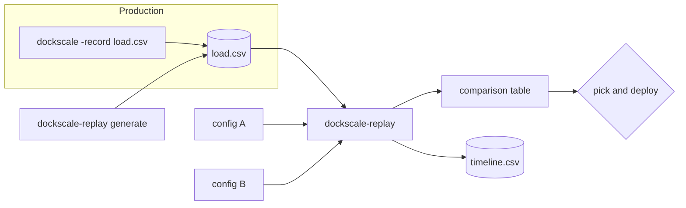
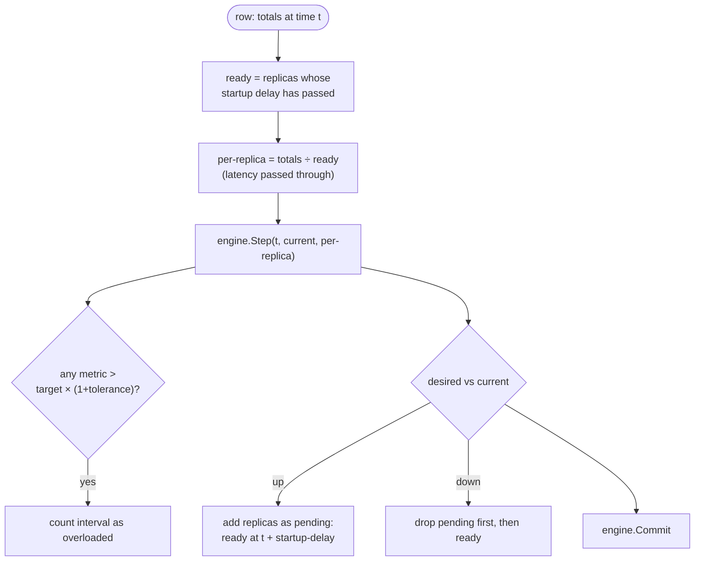

# Replay and tuning

`dockscale-replay` answers one question: *how would this config have behaved on
that traffic?* It runs recorded load through the **same `engine.Engine`** the
live controller uses, with a simulated replica count and no Docker involved.



## Recording

```sh
dockscale -config dockscale.yaml -record load.csv
```

On every tick, each service appends one row (the file is opened in append mode,
so restarts keep adding to it):

```csv
timestamp,service,replicas,cpu,memory,rps,latency_p95,queue_depth
2026-01-05T14:00:00Z,web,4,180.000,,212.400,95.000,
```

Rows hold **service-wide totals**, not per-replica values:

| Column | Stored as |
|---|---|
| `cpu`, `memory` | Per-replica average × replicas, i.e. summed % |
| `rps` | Total requests/second |
| `queue_depth` | Total backlog |
| `latency_p95` | As observed (not additive) |
| `replicas` | How many replicas production actually ran |

Empty cells mean "not observed this tick". Totals are stored because the
simulator runs a *different* number of replicas than production did. It needs
the demand itself, so it can divide it by the simulated replica count.

## Generating synthetic load

When no recording is available yet:

```sh
dockscale-replay generate -out load.csv -days 3 -base 20 -peak 400 -interval 10s
```

This produces a daily sine wave with the trough at 03:00 and the peak at 15:00,
Gaussian noise (`-noise`, default 8%), and random 2.5× spikes lasting 3 ticks
(`-spike-p`, default 0.2% per tick). CPU is modelled as proportional to rps
(`-cpu-per-rps`).

## Simulating

```sh
dockscale-replay -in load.csv \
  -config examples/policies/ewma.yaml \
  -config examples/policies/holt_winters.yaml \
  -startup-delay 15s -timeline timeline.csv
```

The simulator, for each recorded row:



There are two replica counts in the simulation:

- **`current`** is what the policy sees, and it includes replicas still
  starting. This matches the live controller, which counts a container as soon
  as it exists.
- **`ready`** is what actually carries load. Only replicas past
  `-startup-delay` share the demand. That's how the replay captures the cost of
  slow start-up: during that delay, the existing replicas carry everything.

## Reading the output

```
config                 model         ticks  scale-ups  scale-downs  peak  replica-h  overload  overload %
policies/ewma.yaml     ewma          25920         52           76    12      370.9   57m30s       1.33
policies/holt_winters  holt_winters  25920         93          178    15      428.2   25m10s       0.58

recording itself ran 401.3 replica-hours     ← only for real recordings
```

| Column | Meaning | Lower is… |
|---|---|---|
| `scale-ups`, `scale-downs` | Number of scaling actions | less churn |
| `peak` | Maximum replicas | a smaller worst case |
| `replica-h` | Sum of replicas × time: **cost** | cheaper |
| `overload` | Time when load per *ready* replica exceeded `target × (1 + tolerance)`: **risk** | safer |

Tuning means trading `replica-h` against `overload`. The recording's own
replica-hours (shown when the CSV has a `replicas` column) is the baseline to
beat.

The `-timeline` CSV has one row per tick, for plotting or inspecting a
particular moment:

```
timestamp,replicas,ready,desired,overload,rps_raw,rps_estimate,rps_target,…,reason
```

## A tuning workflow

1. Record a representative period: at least a few days, and two full seasons
   if you use Holt-Winters.
2. Measure how long a real replica takes from `docker run` to serving traffic,
   and pass it as `-startup-delay`.
3. Start from your current config as the baseline. Change **one** setting at a
   time in copies under `examples/policies/`.
4. Compare. Keep changes that reduce overload without large cost increases.
5. Run the live controller with `-dry-run` for a while and check that the logged
   decisions match the replay.

## Limits of the simulation

- **It assumes load divides evenly across ready replicas.** That's close for
  CPU, rps and queue backlog behind a load balancer. Latency is replayed as
  recorded, because the simulator can't know how latency would have changed
  with a different replica count. Treat latency-driven results with caution.
- **It assumes demand doesn't depend on capacity.** In reality, an overloaded
  service may see retries (more demand) or users leaving (less).
- **Interval mismatch.** If the recording's median row spacing differs from the
  config's `interval` by more than about 20%, a warning is printed, because
  cooldowns, `horizon` and the Holt-Winters season are counted in ticks.
- Start failures and image pulls aren't simulated.

Speed: about 2.3 µs per tick, so 3 days at 10s (25,920 ticks) replays in about
60 ms.
