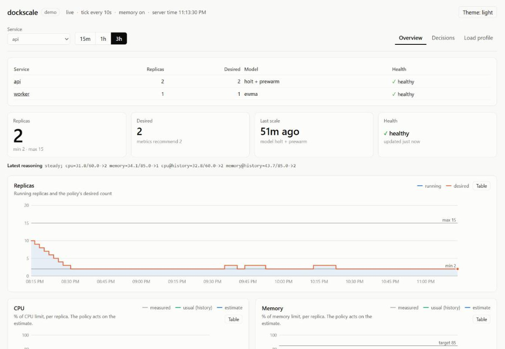
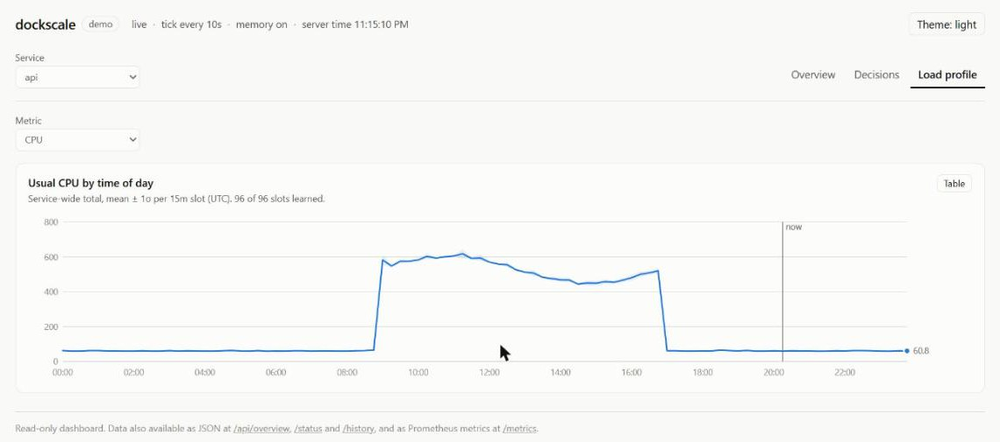

# Web UI

dockscale serves a read-only dashboard on the same port as its API. Open
`http://<host>:9090/`; it redirects to `/ui/`.



It's plain HTML, CSS and JavaScript, compiled into the binary with `go:embed`.
There's no build step, no third-party code and no CDN, so it works offline
and adds no dependencies (ADR [0014](decisions/0014-embedded-read-only-ui.md)).

## Trying it without Docker

```sh
go run ./cmd/dockscale-demo        # then open http://localhost:9090
```

The demo runs the real controller, memory and UI against an in-memory fake
Docker with synthetic load for two services:

- `api` has business-hours traffic, 09:00–17:00 UTC, with `holt` and prewarm.
- `worker` has a nightly batch, 01:00–03:00 UTC, with `ewma`.

It fast-forwards three simulated days (about 2 seconds), so history, grades
and the load profile are already populated, then ticks once per real second
(10× speed; set it with `-speed`). The header shows a **demo** badge.

Flags: `-listen` (default `:9090`), `-days`, `-speed`, `-memory-dir` (default:
a fresh temp directory).

## Views

The filter row at the top scopes everything below it: **service**, **time
range** (15m / 1h / 3h; the controller keeps 3 hours per service), and the
view tabs. The page refreshes every 5 seconds and pauses while the browser tab
is hidden. If the API can't be reached, the last data stays on screen, dimmed,
with a banner explaining why.

### Overview

- **A services table**, shown when more than one service is configured.
- **Stat tiles:** running replicas (the headline number, with min and max),
  desired and recommended counts, time since the last scale, and health (✓
  healthy, or ✕ error with the controller's last error).
- **Latest reasoning:** the policy's reason string for this tick.
- **Replicas chart:** running replicas (filled area) and the desired count
  (line), with min and max reference lines.
- **One chart per metric:** the raw measurement (muted gray), the estimate the
  policy acts on (blue), the profile's "usual" value when `history.prewarm` is
  on (green), and the target line. Each metric gets its own chart because the
  units differ, so there's never a second y-axis.

The signal charts make model behaviour visible. In the demo, for example, the
`holt` estimate visibly overshoots the raw CPU on spikes: with `horizon: 3`,
Holt multiplies short-term trends by three. That's worth knowing before
choosing `horizon`.

### Decisions

- **Verdict counts:** effective, insufficient and unnecessary scale-ups, and ok
  and premature scale-downs. Each status is shown as an icon plus a label,
  never by color alone.
- **Tuning advice** from `memory.Analyze`, the same logic as
  `dockscale-memory report`.
- **Recent decisions** (the last 100): when, the change (with "wanted N" if the
  action was only partly completed), the verdict, how much of the evaluation
  window was overloaded, and the full reason.

Without `memory.dir`, this covers only decisions since the process started.

### Load profile



The learned profile for one metric: the mean per slot with a ±1σ band, slot
times in UTC, a "now" marker, and visit counts in the tooltip and table. It
appears once the service has a profile, meaning `history` is configured; the
defaults always configure one.

## Charts

Every chart has:

- **A hover crosshair** that snaps to the nearest tick, with one tooltip
  listing every series plus the reference values. Keyboard users can focus the
  chart and use ← and →; Esc hides the tooltip.
- **A Table button** that shows the same data as a table (newest first, up to
  500 rows), the accessible twin of the chart.
- **A legend** whenever there are two or more series, plus direct end labels
  when they don't collide.

Colors come from a palette validated for color-vision deficiency and contrast
in both light and dark mode. The theme follows your system unless you pick
one with the Theme button. Your theme, service, tab and time range are
remembered per browser (in `localStorage`, ignored if storage is blocked).

## API used by the UI

| Endpoint | Returns |
|---|---|
| `GET /api/overview` | Server time, interval, dry-run and memory flags, and per service: min/max, metrics and targets, model, prewarm, behavior, latest status |
| `GET /api/series?service=&window=` | Ticks in the window (Go duration, default `1h`, up to 3h kept): replicas, desired, every signal |
| `GET /api/history?service=&limit=` | Recent decisions with outcomes (same as `/history`) |
| `GET /api/report?service=` | Verdict counts, actions per hour, advice |
| `GET /api/profile?service=` | Per-slot mean, stddev and visits for every metric, plus the current slot |

`/api/*` responses are compact JSON with `Cache-Control: no-store`. `/status`
and `/history` stay indented for reading with `curl`.

**Never published:** image, env, labels, and Prometheus or queue URLs (which
can contain credentials). `TestUIAndAPI` checks that a queue password doesn't
appear in `/api/overview`.

## Security

The dashboard and API are **read-only and unauthenticated**. There's
deliberately no scale button, pause switch or config editor, because anyone who
can reach port 9090 could use them. Keep the port on a trusted network, or put
an authenticating reverse proxy in front.

## Changing the UI

The files are in `internal/ui/static/`: `index.html`, `style.css` and
`app.js`. Edit them and rebuild; there's nothing else to run.

- Insert API data with `textContent` (the `h()` helper), never `innerHTML`.
- Keep color in the CSS tokens at the top of `style.css`. Re-validate the
  palette if you change series colors.
- Charts use the `lineChart()` component in `app.js`; its options are
  documented above the function.
- For a quick check, `node --check internal/ui/static/app.js` parses the
  script. `go run ./cmd/dockscale-demo` shows it with live data.
